# طلبات مطبخ التراث على iPhone Duo — الامتداد الكامل والتكيّف (13 نوفمبر 2026)

نطاق هذه الجولة طبقة العرض فقط. لم يُمَسّ الخادم ولا المصادقة ولا قواعد Firestore ولا الدفع ولا منطق الطلبات ولا ملفات النشر (`cloudbuild.yaml` و`firebase.json` و`vercel.json` و`.github/workflows`) ولا الأسرار.

رموز الحالة: `PASS` تحقق مُشاهد/مُختبر، `PARTIAL` جزئي، `FAIL` خلل باقٍ، `BLOCKED` يحتاج جهازًا أو إذنًا، `NOT_APPLICABLE` غير ذي صلة، `NOT_TESTED` لم يُختبر.

## 0. مصدر التعليمات

الملف الرئيسي `~/Desktop/00_MASTER_CLAUDE_CODE_AR.txt` **لم يكن موجودًا على القرص** وقت العمل (وكذلك وجدته جلسة Mizan). اتُّبع بدلًا منه: `~/duo-work/RUN_2026-11-13.md` (التفويض والحدود)، و`~/duo-work/DUO_BRIEF.md`، وتعريفات الوضعيات A–J كما وثّقتها جولة Orbit في اليوم نفسه. ما سبق إنجازه في الجولات السابقة (`src/duo.css`، و`src/beauty-pass.css`، و`docs/duo-evidence/`) لم يُعَد بناؤه.

## 1. نوع المشروع ومسار العرض

- React 19 + Vite 6 + Tailwind 4، يخدمه Express ([server.ts](../server.ts)). الصفحات: المنيو `/` (الترحيب، المنيو، ورقة المنتج، السلة والدفع)، والتتبع `/track`، والقطية `/split/:id`، و404.
- الأشكال موزعة على [src/index.css](../src/index.css) وطبقات لاحقة، آخرها [src/duo.css](../src/duo.css) الذي يُحمَّل أخيرًا. كل قواعد هذه الجولة في آخر `duo.css`.
- غلاف iOS في [apple/](../apple/) لم يُبنَ ولم تُغيَّر إعداداته (`NOT_TESTED`).

## 2. خط الأساس قبل التعديل (`origin/main` = `220f623`)

| الفحص | النتيجة |
|---|---|
| `npm ci` | PASS |
| `npm run lint` (`tsc --noEmit`) | PASS |
| `npx vitest run` | PASS: 183/183 |
| `npm run build` | PASS (وCI على `220f623` ناجح) |
| `npx eslint .` (ليس ضمن CI) | 176 خطأ موجودة مسبقًا على `main` (أغلبها `ban-ts-comment` و`no-explicit-any`). لم تُعالَج لأنها خارج النطاق |
| مصفوفة WebKit «قبل» على الموقع الحي (13 مقاسًا × 10 شاشات) | 0 تمرير أفقي. وظهرت العيوب في القسم 3 |

ملاحظة نشر سابقة للتعديل: الموقع الحي كان يقدّم `a6a20737` بينما `main` = `220f623`، لأن مُشغِّلي Cloud Build معطّلان (انظر القسم 10).

## 3. ما وُجد وما أُصلح من جذوره

| # | العَرَض (قبل) | الجذر | الإصلاح |
|---|---|---|---|
| 1 | صفحة القطية بخطأ (رابط قديم أو خاطئ) تعرض أيقونة وجملة «الطلب غير موجود» فقط، بلا أي زر. على كل المقاسات | شاشة الخطأ بلا مخرج | بطاقة بنفس شكل صفحة 404، مع زرين: «تتبع طلباتك» و«الرجوع للمنيو» ([SplitPayment.tsx](../src/pages/SplitPayment.tsx)) |
| 2 | في التتبع على 594×368 (مطوي عرضي) وعلى الآيفون العرضي: شريط زخرفي ثابت بتدرج أبيض يقطع حقل «رقم الطلب» وزر البحث | `<footer class="fixed bottom-0 …">` زخرفي فوق المحتوى القابل للتمرير | حُذف. لا يحمل أي معلومة ([OrderPage.tsx](../src/pages/OrderPage.tsx)) |
| 3 | التتبع على 382: النص الإرشادي «…م التلفون (مثل: 9999 9999)» مقطوع. وعلى 320 يظهر «(مثل: 9999 9999)» فقط | هامش 24 + حشو البطاقة 32 + 48px على **جهتي** كل حقل، والأيقونة على جهة واحدة | تحت 480px: هامش 16، وحشو 22/18، والحقل 48px جهة الأيقونة و16px في الجهة الأخرى (الحقول `dir=ltr`، فالجهة فيزيائية). تحت 360: خط الإرشاد 13px. النص كامل الآن على 382 و385 و320 |
| 4 | السلة والدفع على 669 (الشاشة الداخلية طوليًا) و640–680: الزاويتان اليسريان مستديرتان فتظهر خلفية المنيو المعتمة عند الحافة | `sm:rounded-l-3xl` يفترض أن اللوح جانبي من 640px، لكن عرضه الأقصى 680 فيملأ النافذة كلها حتى 680 | `@media (max-width: 680px)`: حواف مربعة وبلا حد جانبي. من 768 فأكثر يبقى لوحًا جانبيًا مستديرًا كما هو |
| 5 | ورقة المنتج ونوافذ أخرى: `max-h-[92vh]` و`[90vh]` و`[85vh]` و`[94vh]` و`max-height:92vh` | `vh` في Safari = الارتفاع الأكبر (دون شريط العنوان)، فيقع أسفل الورقة (زر الإضافة) تحت أشرطة Safari | كلها `dvh` في 5 ملفات، مع اختبار يمنع عودة `vh` |
| 6 | ورقة المنتج على النوافذ القصيرة العريضة (594×368، و951×350، والآيفون العرضي): الصورة 112px والعنوان والسعر فوق بعض، وشريط «حطه بالسلة» اللاصق يغطي صندوق الملاحظات | تخطيط عمودي واحد لكل الارتفاعات | `(min-width: 520px) and (max-height: 520px)`: الصورة 76px بجانب العنوان والسعر، ومقبض السحب مخفي. على 594×368 صار صندوق الملاحظات كاملًا فوق الشريط. على 951×350 يبقى الشريط فوق أسفل الصندوق قليلًا (PARTIAL) |

لم تُضَف قواعد `viewport-segments` أو `device-posture`: اختبار موجود في المستودع ([src/tests/duo-audit.test.ts](../src/tests/duo-audit.test.ts)) يمنعها في `index.css` و`duo.css` لأن الـ API معطّل افتراضيًا في Safari. احترمتُ هذا القرار السابق.

## 4. فحص الامتداد الكامل

| البند | الحالة | الدليل |
|---|---|---|
| خلفيات الشاشات حتى الحافة | PASS | `min-h-dvh` على الجذر وكل الصفحات، ولوح الدفع صار مربعًا حين يملأ النافذة |
| حواف الأمان | PASS (مراجعة كود) | `viewport-fit=cover`، و`safe-area-inset-*` على شريط السلة ورأس الدفع والترحيب، وهامش التتبع الجديد يأخذ `max(16px, env(safe-area-inset-left/right))`. حواف Playwright صفر فلم تُقَس |
| تمرير أفقي | PASS | 0 في 143 لقطة «بعد» (13 مقاسًا × 11 حالة) |
| وحدات الارتفاع | PASS | لا `vh` في النوافذ والأوراق (اختبار جديد) |
| لوحة المفاتيح | NOT_TESTED | المحاكاة لا تُظهر لوحة مفاتيح حقيقية |

## 5. مصفوفة الوضعيات A–J (Playwright WebKit بملف Safari المحمول، DPR 2، تقليل الحركة، كل طلبات الكتابة محجوبة)

| الوضعية | المقاس | الترحيب | المنيو | المنتج | السلة/الدفع | التتبع | القطية (خطأ) | 404 / دون اتصال | الحالة |
|---|---|---|---|---|---|---|---|---|---|
| A مطوي طولي | 382×580 | ✓ | ✓ | ✓ | ✓ | ✓ (الإرشاد كامل) | ✓ (بمخرجين) | ✓ | PASS (محاكاة) |
| B مطوي عرضي | 594×368 | ✓ عمودان | ✓ | ✓ الصورة بجانب العنوان | ✓ | ✓ بلا شريط فوق الحقول | ✓ | ✓ | PASS (محاكاة) |
| C مفتوح طولي | 669×880 | ✓ | ✓ | ✓ | ✓ حواف مربعة | ✓ | ✓ | ✓ | PASS (محاكاة) |
| D مفتوح عرضي | 951×600 | ✓ | ✓ | ✓ | ✓ لوح جانبي 720 | ✓ | ✓ | ✓ | PASS (محاكاة) |
| E كتاب | مفصل عمودي x≈334 | — | — | — | — | — | — | — | BLOCKED: الـ API خلف علم في Safari 27.1، واختبار المستودع يمنع قواعده. لم يُحاكَ |
| F طاولة | مفصل أفقي y≈334 | — | — | — | — | — | — | — | BLOCKED: للسبب نفسه |
| G نافذتان | 385×571 | ✓ | ✓ | ✓ | ✓ | ✓ | ✓ | ✓ | PASS (محاكاة) |
| H Split | 320 / 470 / 620 ×600 | ✓ | ✓ | ✓ | ✓ | ✓ (320: الإرشاد كامل الآن) | ✓ | ✓ | PASS (محاكاة) |
| I خيمة/حامل | — | — | — | — | — | — | — | — | NOT_TESTED: لا runtime يعلنها |
| J انتقال حي | 951→669→470→382→594→951 دون إعادة تحميل | | | | ✓ لوح الدفع بقي مفتوحًا، والحواف 32px ثم 0 ثم 32px | ✓ الرقم المكتوب بقي | | | PASS: 0 تنقلات، 0 تمرير أفقي |

مقاسات إضافية: 669×520 (لوحة مثبتة)، و951×350، و390×844، و844×390، و1440×900. كلها بلا تمرير أفقي، وكلها وصلت إلى شاشة الدفع. 951×350: ورقة المنتج PARTIAL (البند 6).

## 6. صور قبل/بعد

| الحالة | قبل | بعد |
|---|---|---|
| A التتبع 382×580 | 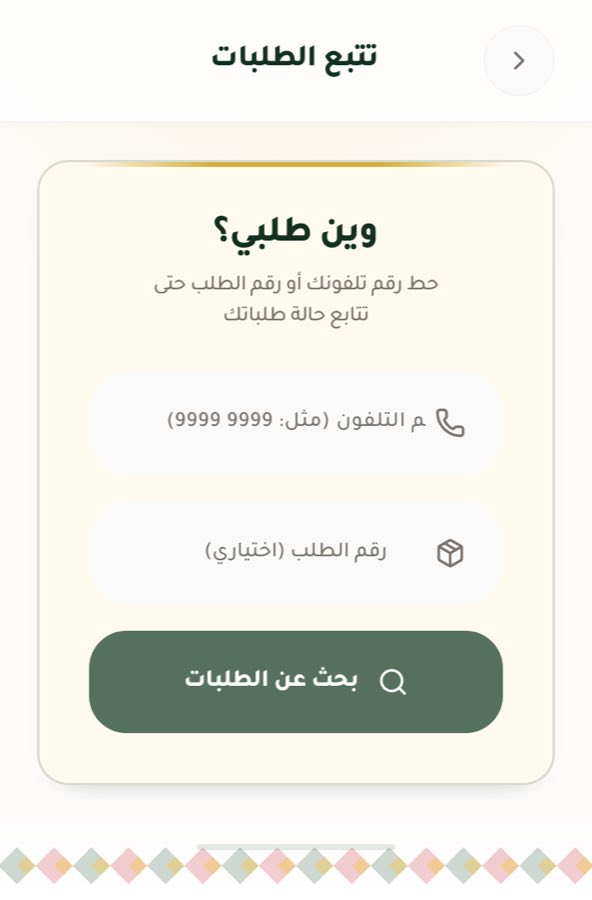 |  |
| A القطية بخطأ | 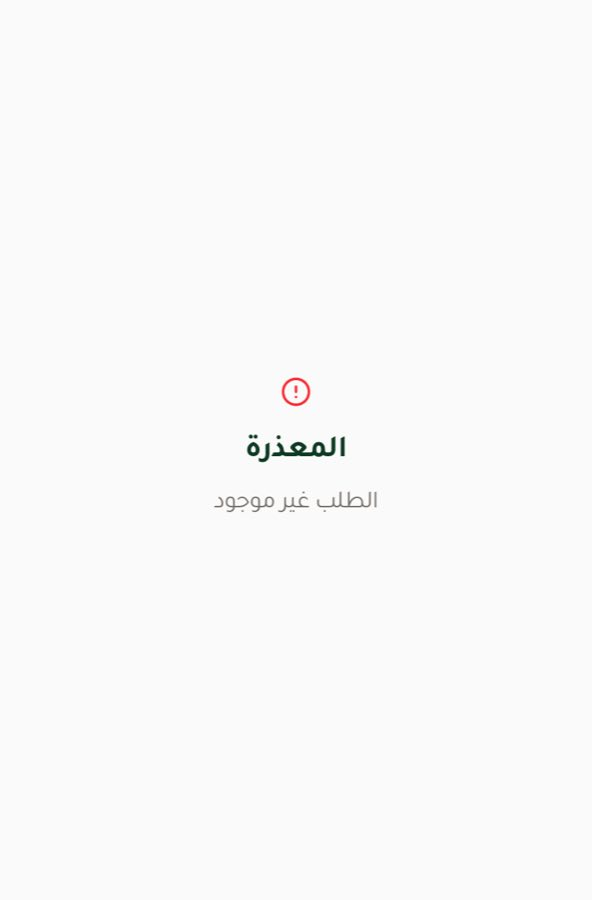 | 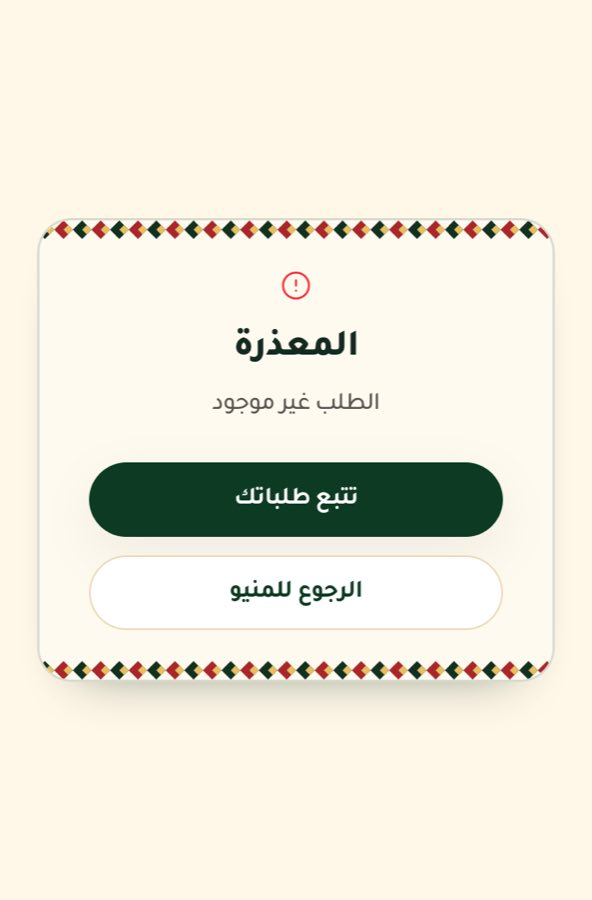 |
| B التتبع 594×368 |  |  |
| B المنتج 594×368 | 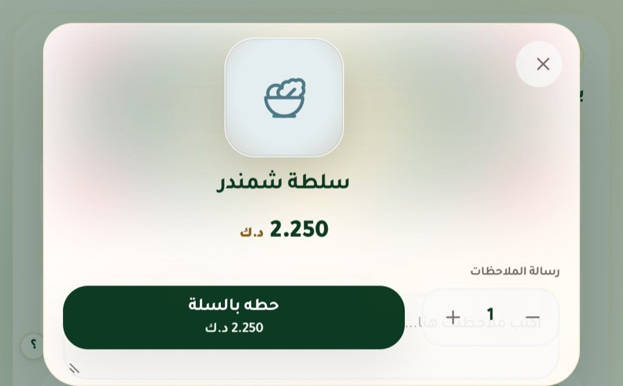 | 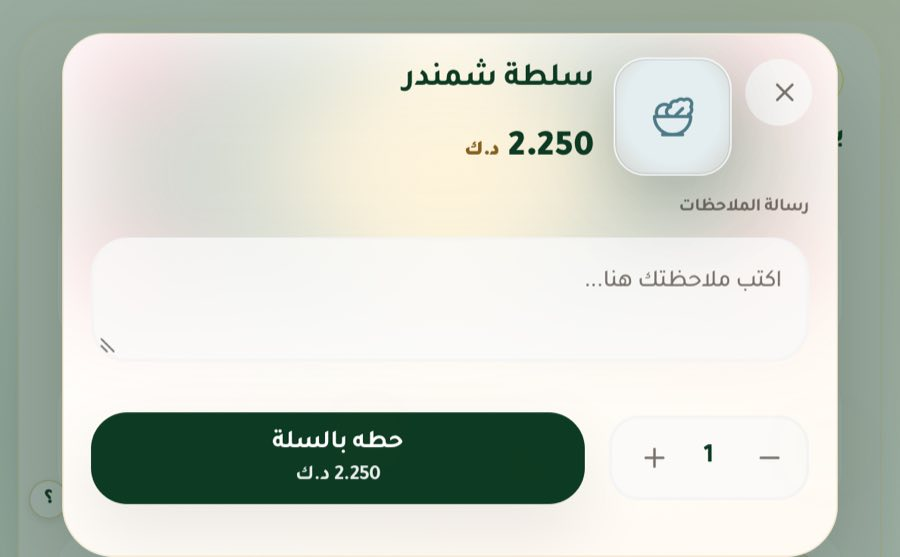 |
| C الدفع 669×880 | 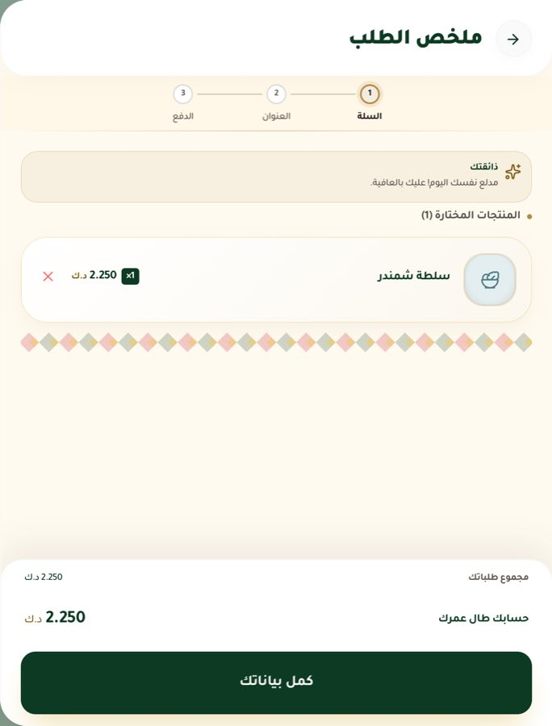 | 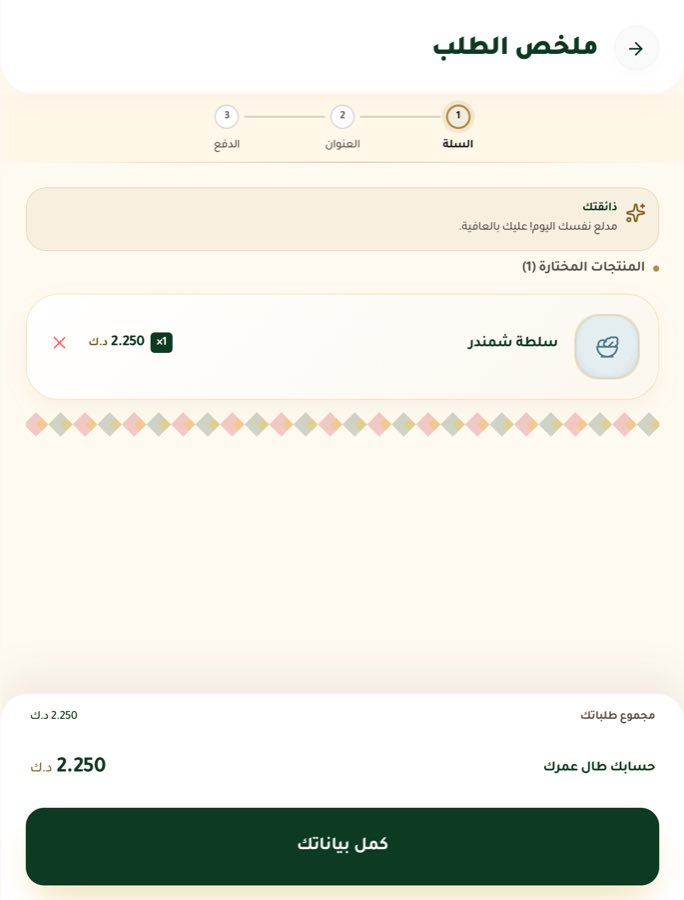 |
| H التتبع 320×600 | 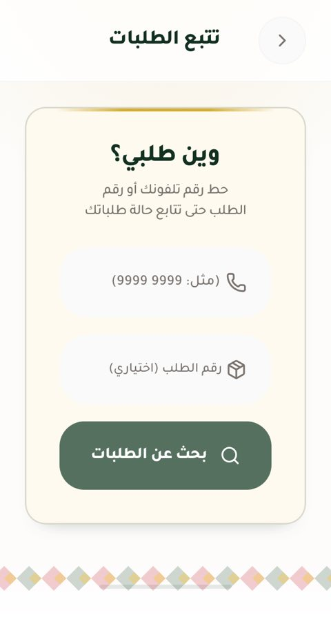 | 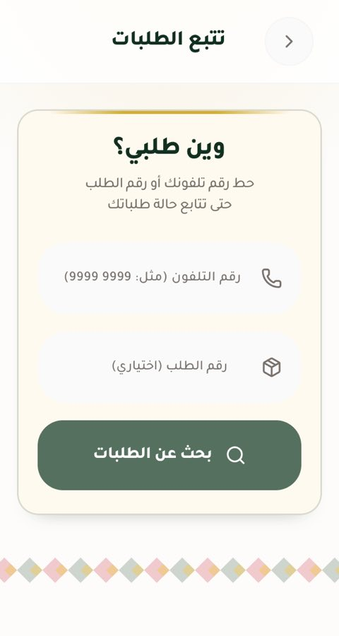 |
| المنتج 951×350 (PARTIAL) | لم تُلتقط قبل | 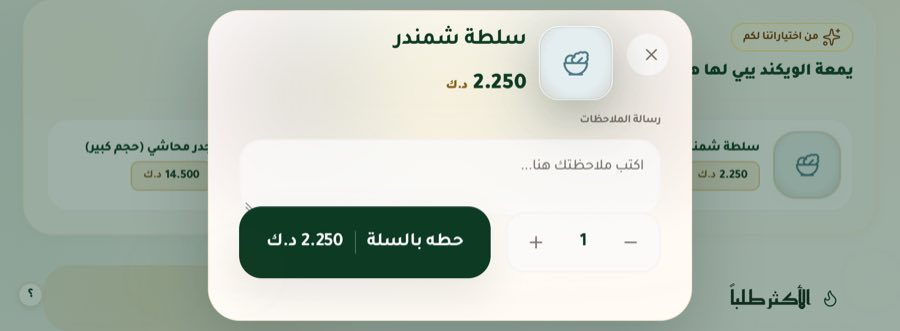 |
| J بعد الانتقال إلى 382×580 | | 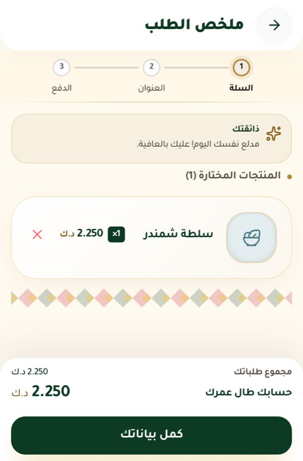 |

## 7. الوصول والاتجاه

- RTL: كل الشاشات `dir=rtl`. PASS.
- التكبير غير مقفول، و`touch-action: manipulation` (اختبار موجود). PASS.
- أهداف اللمس: زرا شاشة القطية الجديدان `min-h-12` (48px). مدقق المصفوفة: 0 عناصر تفاعلية أصغر من 32px في الشاشات الملتقطة. PASS.
- تقليل الحركة: لا حركة جديدة. PASS.
- VoiceOver حقيقي: NOT_TESTED.

## 8. الأداء

لم تُقَس Core Web Vitals (NOT_TESTED). التعديل CSS (+~70 سطرًا) وتغيير JSX بسيط، بلا JavaScript جديد ولا مراقبي resize.

## 9. الاختبارات بعد التعديل

| الأمر | النتيجة |
|---|---|
| `npm run lint` | PASS |
| `npx vitest run` | PASS: 186/186 (3 اختبارات جديدة في `duo-audit.test.ts`: `dvh` للأوراق، ومخرجا شاشة خطأ القطية، وحواف لوح الدفع) |
| `npm run build` | PASS (القاعدة الجديدة موجودة في CSS المبني) |
| مصفوفة WebKit «بعد» على البناء المحلي | 143 لقطة، 0 تمرير أفقي، كل المسارات وصلت إلى الدفع |
| الانتقال الحي | PASS |

طريقة الاختبار الآمنة: خادم محلي يقدّم `dist/` ويمرّر طلبات `GET /api/*` فقط إلى الموقع الحي، ويرد 503 على كل ما سواها. وPlaywright يحجب أي طلب غير `GET` أيضًا. لم يُرسَل أي طلب أو دفع أو كتابة.

## 10. النشر

- **مُشغِّلا Cloud Build** على المشروع `gen-lang-client-0200723670` (`order-main-deploy` و`rmgpgab-order-…`) **معطّلان** (`gcloud builds triggers list` يعرض `DISABLED: True`). فالدمج إلى `main` لا ينشر.
- `vercel.json` غير مستخدم: لا توجد أي GitHub deployments ولا حالات Vercel على الكوميتات.
- المسار الوحيد العامل: سير العمل اليدوي **«Deploy hosting»** ([.github/workflows/deploy.yml](../.github/workflows/deploy.yml))، وهو `workflow_dispatch` فقط. حسب تعليمات هذه الجولة لم يُشغَّل يدويًا. أمر النشر للمالك:

```
gh workflow run "Deploy hosting" --ref main -R ProfAlfailakawi/Order-New-2026
```

ثم التحقق من `https://alturathkw.shop/build-id.json` (يجب أن ينتهي بأول 8 أحرف من commit الدمج).

## 11. ما يجب فحصه على جهاز حقيقي

1. المطوي 382×580: افتح `/track`، هل نص «رقم التلفون (مثل: 9999 9999)» كامل؟
2. المطوي عرضيًا: افتح أي صنف، هل صندوق الملاحظات ظاهر فوق زر «حطه بالسلة»؟
3. الشاشة الداخلية طوليًا: افتح السلة، هل اللوح يملأ الشاشة بلا زوايا مستديرة عند الحافة اليسرى؟
4. افتح `/split/أي-رمز`: هل يظهر الزران؟
5. Safari بشريط عنوان ظاهر: هل زر «حطه بالسلة» أسفل ورقة المنتج ظاهر دائمًا (`dvh`)؟
6. E/F: تحتاج تفعيل علم Viewport Segments، وقرارًا من المالك بتغيير الاختبار الذي يمنع قواعدها.
