# طلبات مطبخ التراث على iPhone Duo — القبول النهائي: الشاشة الداخلية «كتاب» (14 نوفمبر 2026)

هذه الجولة تبني على [IPHONE-DUO-ADAPTIVE-QUALITY.md](IPHONE-DUO-ADAPTIVE-QUALITY.md) و`docs/iphone-duo/` و`docs/duo-evidence/`. النطاق طبقة العرض فقط. لم يُمَسّ الخادم ولا الدفع ولا الطلبات ولا الأسعار ولا قاعدة البيانات ولا قواعد Firestore ولا المصادقة ولا ملفات النشر ولا سير عمل CI. لم يُنشأ أي طلب ولا أي دفع: كل طلب غير `GET` يُرَدّ عليه محليًا قبل أن يغادر المتصفح.

رموز الحالة: `PASS` مُقاس ومُشاهَد في المحاكاة، `PARTIAL` يعمل مع ملاحظة، `FAIL` خلل باقٍ، `BLOCKED` لا يمكن الوصول إليه دون بيانات حقيقية أو كتابة على الخادم، `NOT_TESTED` لم يُختبر، `N/A` لا ينطبق. **كل النتائج من Playwright WebKit (محاكاة). لم يُختبر شيء على جهاز حقيقي.**

## 1. المشكلة وما تغيّر

على الشاشة الداخلية (669×867 كتاب طولي، 951×585 كتاب عرضي) كانت كل الشاشات عمودًا واحدًا ممطوطًا في الوسط، وكان النص والأزرار تقع على المفصل. القياس على `main` قبل التعديل: **440** عنصرًا (نص أو زر أو حقل) يقطع منطقة المفصل في 28 شاشة × مقاسين.

الآن الشاشة الداخلية صفحتان بينهما كعب هادئ بعرض 32px (خط ذهبي رفيع وظل طيّ خفيف، فوق كل شيء ولا يلتقط اللمس). الخلفية متصلة من الحافة إلى الحافة. الصفحة اليمنى للمهمة (تبدأ القراءة منها)، واليسرى للسياق:

| الشاشة | الصفحة اليمنى (المهمة) | الصفحة اليسرى (السياق) |
|---|---|---|
| المنيو | شريط الديوانية، الرأس، الاختيارات والفئات والأطباق (طبق في كل صف كالجوال) | غلاف «مزاج اليوم» بطول الصفحة، البحث، وشريط السلة في أسفلها. ثابتة أثناء التمرير |
| ورقة المنتج | الصورة والاسم والسعر | الإضافات والملاحظات، والكمية وزر «حطه بالسلة» في أسفل الصفحة |
| السلة والدفع | العنوان والخطوات والنموذج | «صفحة الفاتورة»: شعار المطبخ في رأسها، والمجموع والخصم وزر الخطوة التالية في أسفلها. والمطعم مغلق: الشعار صفحة عنوان، والأسبوع في عمود واحد |
| التتبع | بطاقة البحث (ثابتة) | الطلبات والعضوية. قبل البحث: صفحة عنوان بشعار المطبخ |
| القطية | التبويبات والمحتوى والدفع | صفحة عنوان الطلب: «قطيّة الربع»، صاحب الطلب، العنوان |
| الوهق (الروليت) | الأسماء وزر النبضة | بطاقة «وهق غيرك» والحالة |
| 404 / رابط قطية خاطئ | العنوان والشرح وأزرار الرجوع | الرسم |
| الترحيب الأول | الشعار والوعد | الدخول للمنيو والديوانية |
| النوافذ الوسطية (19 نافذة) | النافذة نفسها | المحتوى خلفها معتمًا |

قرارات تقنية:

- **من مقاس النافذة فقط**: `(min-width:640px) and (max-width:720px) and (min-height:760px) and (max-height:1000px)` للكتاب الطولي، و`(min-width:860px) and (max-width:1000px) and (min-height:520px) and (max-height:700px)` للعرضي. iPad (768+ طوليًا و1024+ عرضيًا) والجوال والنوافذ القصيرة لا تتأثر.
- **CSS خالص**: لا JavaScript جديد، ولا عرض مشروط حسب المقاس، فلا يُعاد تركيب أي مكوّن عند فتح الجهاز أو طيّه. التغيير الوحيد في JSX: غلاف `div.duo-context-page` حول البانر والبحث (وهو `display: contents` خارج الكتاب، فلا أثر له على التخطيط)، وصنف `duo-page-dialog` على 19 حاوية نافذة.
- **مكان القواعد**: كلها في [src/duo.css](../src/duo.css) (الطبقة التي تُحمَّل أخيرًا). `!important` استُعمل فقط حيث يفرض `index.css` أو `beauty-pass.css` القيمة نفسها بـ`!important` (عرض ورقة المنتج ولوح الدفع وموضع شريط السلة وحشو تذييل الدفع)، وكل موضع معلَّق عليه.
- **المفصل الحقيقي (Viewport Segments)**: لم يُضَف. اختبار المستودع `duo-audit.test.ts` يمنع `viewport-segments` في `duo.css` و`index.css` لأن الواجهة معطّلة افتراضيًا في Safari. احترمتُ القرار. الكعب يقع في منتصف النافذة بالضبط، وهو موضع المفصل حين يكون الجهاز مفتوحًا بالكامل.

## 2. ما أُصلح أيضًا خارج الكتاب

| # | الوضعية | العَرَض قبل | الجذر والإصلاح |
|---|---|---|---|
| 1 | B وE (594×368، 600×350، 951×350، 844×390) | ورقة المنتج: مربع اختيار الإضافة 80×80 فارغ، وسعر الإضافة مقصوص عند الحافة، وشريط «حطه بالسلة» يطفو فوق الملاحظات | قاعدة في `index.css` للنوافذ القصيرة كانت تطابق بطاقات الإضافات أيضًا (محدِّد سليل بدل ابن مباشر). صُحِّح المحدِّد من جذره، وصارت الورقة صفحتين: الطبق يمينًا، والإضافات والملاحظات تتمرر يسارًا وتحتها الكمية والزر في مكانهما من التدفق |
| 2 | E وB | الدفع، خطوة العنوان: زر الخطوة التالية غير ظاهر (سقط إلى صف ثالث تحت سقف 30dvh)، وسلة الطلب لا يظهر منها إلا ~40px | ملاحظة وقت التحضير صارت بعد الزر، ولوح الدفع صار صفحتين في النوافذ القصيرة العريضة أيضًا: النموذج يمينًا والفاتورة والزر يسارًا |
| 3 | G (1024+) | أهداف لمس 40px و42px و24px (زر التتبع في الرأس، أزرار شريط السلة، زر «طريقة الدفع»، أزرار «قسمة على 2/3/4») | كلها 44px على الأقل |
| 4 | الكل | نافذة «اقتراح اليوم» (تظهر بعد 9 ثوانٍ) كانت على المفصل | صارت نافذة صفحة |

## 3. تعريف الوضعيات

| | الوضعية | المقاسات |
|---|---|---|
| A | الخارجية مطوية طوليًا | 382×580، 385×571، 320×568 |
| B | الخارجية عرضيًا | 594×368 |
| C | الداخلية كتاب طولي | 669×867 |
| D | الداخلية كتاب عرضي | 951×585 |
| E | لابتوب | 951×350، 600×350 |
| F | داخلية قصيرة / نصف | 669×520، 600×480 |
| G | تابلت/مكتب | 768×1024، 1024×768، 1280×800، 1440×900 |
| H | مراجع الجوال | 360×640، 390×844، 844×390 (+ Split: 320/470/620 × 350/600/900) |
| I | انتقال حي على صفحة واحدة | 951×585 → 669×867 → 470×700 → 382×580 → 594×368 → 951×350 → 951×585 |
| J | إجهاد الوصول | نص 200%، داكن، حركة كاملة، لوحة مفاتيح (ارتفاع 350 مع حقل مُركَّز)، حواف أمان غير متماثلة |

## 4. جرد الشاشات (من الموجّه والنوافذ في الكود)

المسارات في [src/App.tsx](../src/App.tsx): `/` (المنيو)، `/track`، `/split/:id`، `/admin/*` (تحويل إلى تطبيق الإدارة الخارجي)، و`*` (404). والنوافذ من بحث `role="dialog"` و`fixed inset-0` في `src/`.

| المعرّف | الشاشة | الوصول في التدقيق |
|---|---|---|
| welcome | الترحيب أول زيارة | بلا مفتاح `alturath_customer_entry_seen_v1` |
| menu | المنيو أعلى الصفحة | بيانات المنيو الحية (قراءة فقط) |
| menu-dishes | فئة وأطباق | نقر أول فئة |
| menu-search | بحث بالمزاج | كتابة «مجبوس» |
| menu-loading | تحميل المنيو (شاشة الشعار) | طلبات المنيو معلّقة |
| menu-error | فشل تحميل المنيو | طلبات المنيو 500 |
| legal | بيانات السجل التجاري | زر ⓘ |
| welcome-replay | نافذة «كيف تطلب» | زر ؟ |
| diwaniya | نافذة الديوانية (صدارة الدواوين) | شريط الديوانية |
| smart-pick | نافذة «اقتراح اليوم» | انتظار 9 ثوانٍ |
| product | ورقة المنتج | نقر طبق |
| cart-bar | المنيو مع شريط السلة | إضافة طبق |
| checkout-cart | الدفع: السلة | شريط السلة |
| checkout-address | الدفع: العنوان | «كمل بياناتك» |
| checkout-closed | المطعم مغلق + الأسبوع | ساعة 01:30 بتوقيت الكويت |
| track / track-results / track-empty | التتبع: بحث، نتائج، لا طلبات | هاتف تجريبي `99999999` / `90000000` |
| track-profile / track-addresses | الملف: العضوية، عناويني | بطاقة العميل |
| track-detail / track-invoice | تفاصيل الطلب: الحالة، الفاتورة | نقر طلب |
| track-paid / track-payfail | عائد من بوابة الدفع: نجح / فشل | `?payment=success|failed` (العرض فقط، يختفي بعد 3.5 ث) |
| split-overview / split-payment / split-people | القطية: نظرة عامة، قطيتك، المشاركون | طلب تجريبي `DEMO-2001` |
| split-failed | القطية: فشل الدفع | `?payment=failed` |
| split-roulette | الوهق | طلب تجريبي `DEMO-3001` |
| split-paid | القطية مكتملة | `DEMO-1001` |
| split-error | رابط قطية خاطئ | `/split/NOPE-0` |
| not-found | 404 | `/no-such-page` |
| route-loading | تحميل الصفحة (Suspense) | ملف `OrderPage` معلّق |
| offline | بلا اتصال (نافذة + تنبيه) | `context.setOffline(true)` |

الطلبات التجريبية `DEMO-*` يقدّمها الخادم المحلي [serve.mjs](iphone-duo-final/serve.mjs) فقط، وهي بيانات عرض.

## 5. مصفوفة الشاشات × الوضعيات

القياس لكل خلية: تمرير أفقي، عناصر مقصوصة عند حافة النافذة، أهداف لمس أقل من 44px، وفي C وD عناصر تقطع المفصل (المنتصف ± 16px). كل شاشة فُتحت مرة واحدة ثم مرّت على كل المقاسات على **الصفحة نفسها** (بلا إعادة تحميل).

| الشاشة | A | B | C | D | E | F | G | H | I | J |
|---|---|---|---|---|---|---|---|---|---|---|
| الترحيب (أول زيارة) (`welcome`) | PASS | PASS | PASS | PASS | PASS | PASS | PASS | PASS | PASS* | NOT_TESTED |
| المنيو (أعلى الصفحة) (`menu`) | PASS | PASS | PASS | PASS | PASS | PASS | PASS | PASS | PASS* | NOT_TESTED |
| المنيو: فئة وأطباق (`menu-dishes`) | PASS | PASS | PASS | PASS | PASS | PASS | PASS | PASS | PASS | PASS |
| المنيو: بحث بالمزاج (`menu-search`) | PASS | PASS | PASS | PASS | PASS | PASS | PASS | PASS | PASS* | NOT_TESTED |
| المنيو: تحميل (`menu-loading`) | PASS | PASS | PASS | PASS | PASS | PASS | PASS | PASS | PASS* | NOT_TESTED |
| المنيو: فشل التحميل (`menu-error`) | PASS | PASS | PASS | PASS | PASS | PASS | PASS | PASS | PASS* | NOT_TESTED |
| بيانات السجل التجاري (`legal`) | PASS | PASS | PASS | PASS | PASS | PASS | PASS | PASS | PASS* | NOT_TESTED |
| نافذة «كيف تطلب» (زر ؟) (`welcome-replay`) | PASS | PASS | PASS | PASS | PASS | PASS | PASS | PASS | PASS* | NOT_TESTED |
| الديوانية (نافذة) (`diwaniya`) | PASS | PASS | PASS | PASS | PASS | PASS | PASS | PASS | PASS* | NOT_TESTED |
| اقتراح اليوم (نافذة تظهر بعد 9 ثوانٍ) (`smart-pick`) | PASS | PASS | PASS | PASS | PASS | PASS | PASS | PASS | PASS* | NOT_TESTED |
| ورقة المنتج (`product`) | PASS | PASS | PASS | PASS | PASS | PASS | PASS | PASS | PASS | PARTIAL |
| معاينة صورة المنتج (`product-photo`) | BLOCKED | BLOCKED | BLOCKED | BLOCKED | BLOCKED | BLOCKED | BLOCKED | BLOCKED | BLOCKED | BLOCKED |
| المنيو مع شريط السلة (`cart-bar`) | PASS | PASS | PASS | PASS | PARTIAL | PASS | PASS | PASS | PASS* | NOT_TESTED |
| الدفع: السلة (`checkout-cart`) | PASS | PASS | PASS | PASS | PASS | PASS | PASS | PASS | PASS* | NOT_TESTED |
| الدفع: العنوان (`checkout-address`) | PASS | PASS | PASS | PASS | PASS | PASS | PASS | PASS | PASS | PASS |
| الدفع: المطعم مغلق وأوقات العمل (`checkout-closed`) | PASS | PASS | PASS | PASS | PASS | PASS | PASS | PASS | PASS* | NOT_TESTED |
| التتبع: البحث (`track`) | PASS | PASS | PASS | PASS | PASS | PASS | PASS | PASS | PASS | NOT_TESTED |
| التتبع: النتائج (`track-results`) | PASS | PASS | PASS | PASS | PASS | PASS | PASS | PASS | PASS | PARTIAL |
| التتبع: الملف (العضوية) (`track-profile`) | PASS | PASS | PASS | PASS | PASS | PASS | PASS | PASS | PASS* | NOT_TESTED |
| التتبع: الملف (عناويني) (`track-addresses`) | PASS | PASS | PASS | PASS | PASS | PASS | PASS | PASS | PASS* | NOT_TESTED |
| التتبع: لا توجد طلبات (`track-empty`) | PASS | PASS | PASS | PASS | PASS | PASS | PASS | PASS | PASS* | NOT_TESTED |
| التتبع: تفاصيل الطلب (الحالة) (`track-detail`) | PASS | PASS | PASS | PASS | PASS | PASS | PASS | PASS | PASS* | NOT_TESTED |
| التتبع: تفاصيل الطلب (الفاتورة) (`track-invoice`) | PASS | PASS | PASS | PASS | PASS | PASS | PASS | PASS | PASS* | NOT_TESTED |
| التتبع: عائد من الدفع (نجح) (`track-paid`) | NOT_TESTED | NOT_TESTED | PASS | PASS | NOT_TESTED | NOT_TESTED | NOT_TESTED | NOT_TESTED | PASS* | NOT_TESTED |
| التتبع: عائد من الدفع (فشل) (`track-payfail`) | NOT_TESTED | NOT_TESTED | PASS | PASS | NOT_TESTED | NOT_TESTED | NOT_TESTED | NOT_TESTED | PASS* | NOT_TESTED |
| القطية: نظرة عامة (`split-overview`) | PASS | PASS | PASS | PASS | PASS | PASS | PASS | PASS | PASS* | NOT_TESTED |
| القطية: قطيتك (الدفع) (`split-payment`) | PASS | PASS | PASS | PASS | PASS | PASS | PASS | PASS | PASS* | PASS |
| القطية: المشاركون (`split-people`) | PASS | PASS | PASS | PASS | PASS | PASS | PASS | PASS | PASS* | NOT_TESTED |
| القطية: فشل الدفع (عائد من البنك) (`split-failed`) | PASS | PASS | PASS | PASS | PASS | PASS | PASS | PASS | PASS* | NOT_TESTED |
| القطية: الوهق (الروليت) (`split-roulette`) | PASS | PASS | PASS | PASS | PASS | PASS | PASS | PASS | PASS* | NOT_TESTED |
| القطية: اكتملت (`split-paid`) | PASS | PASS | PASS | PASS | PASS | PASS | PASS | PASS | PASS* | NOT_TESTED |
| القطية: رابط خاطئ (`split-error`) | PASS | PASS | PASS | PASS | PASS | PASS | PASS | PASS | PASS* | NOT_TESTED |
| 404 (`not-found`) | PASS | PASS | PASS | PASS | PASS | PASS | PASS | PASS | PASS* | PASS |
| تحميل الصفحة (Suspense) (`route-loading`) | PASS | PASS | PASS | PASS | PASS | PASS | PASS | PASS | PASS* | NOT_TESTED |
| بلا اتصال (`offline`) | PASS | PASS | PASS | PASS | PASS | PASS | PASS | PASS | PASS* | NOT_TESTED |

- `PASS*` في عمود I: الشاشة مرّت على كل المقاسات الـ26 على صفحة واحدة دون إعادة تحميل ودون تمرير أفقي (طريقة المصفوفة نفسها)، دون فحص حالة مكتوبة. الحالات المكتوبة فُحصت في القسم 7.
- `product-photo`: المعاينة لا تفتح لأن بيانات المنيو بلا صور، فالقياس في report.json هو ورقة المنتج نفسها (القسم 10).
- `route-loading`: القياس سليم، لكن لقطة الشاشة لا تُلتقط (الصفحة معلّقة على ملف JS عمدًا).
- `track-paid` و`track-payfail` قيست على 951×585 و669×867 فقط لأن التنبيه يختفي بعد 3.5 ثانية؛ بقية أعمدتها `NOT_TESTED`.
- J لبقية الشاشات `NOT_TESTED` بالقياس الآلي: الإجهاد شُغِّل على 6 شاشات ممثِّلة للأنماط (قائمة، ورقة، نموذج، قائمة نتائج، تبويبات، شاشة خطأ).

## 6. القياسات

ملف القياس: [report.json](iphone-duo-final/report.json) (35 شاشة، 862 قياسًا).

| المقياس | قبل (`main`، 28 شاشة × 6 مقاسات أساسية) | بعد (862 قياسًا) |
|---|---|---|
| تمرير أفقي | 0 | 0 |
| عناصر مهمة مقصوصة عند الحافة | 1 (شريط السلة 600×350) | 1 — cart-bar 600x350 |
| عناصر تقطع المفصل في C وD | 440 | 0 |
| أهداف لمس أقل من 44px | 3 (على المقاسات الستة) + 73 على G في أول تشغيل كامل | 0 |

العنصر المقصوص الوحيد هو شريط السلة لحظة الانتقال بين المقاسات (انظر P2): لا يتكرر حين تُفتح الشاشة على ذلك المقاس.

## 7. الانتقال الحي (I) وإجهاد الوصول (J)

| الحالة | الخطوات (951×585 → 669×867 → 470×700 → 382×580 → 594×368 → 951×350 → 951×585) | النتيجة |
|---|---|---|
| هاتف مكتوب + رقم طلب + نتائج + تمرير | الحالة بقيت في كل الخطوات: نعم، إعادة تحميل: 0، تمرير أفقي: 0، عناصر على المفصل: 0 | PASS |
| ورقة المنتج مفتوحة + ملاحظة مكتوبة + كمية 2 | الحالة بقيت في كل الخطوات: نعم، إعادة تحميل: 0، تمرير أفقي: 0، عناصر على المفصل: 0 | PASS |
| لوح الدفع مفتوح على «العنوان» + رقم مكتوب | الحالة بقيت في كل الخطوات: نعم، إعادة تحميل: 0، تمرير أفقي: 0، عناصر على المفصل: 0 | PASS |
| نص بحث مكتوب في المنيو | الحالة بقيت في كل الخطوات: نعم، إعادة تحميل: 0، تمرير أفقي: 0، عناصر على المفصل: 0 | PASS |

| J | الشاشات | النتيجة |
|---|---|---|
| نص 200% (`html{font-size:200%}`) | 6 شاشات × 669×867، 951×585، 382×580، 951×350 | PARTIAL: product 669x867: زيّد الكمية؛ track-results 669x867: h1 "تتبع الطلبات" |
| `colorScheme: dark` | 6 شاشات × 669×867، 951×585، 382×580، 951×350 | PASS |
| حركة كاملة (`reducedMotion: no-preference`) | 6 شاشات × 669×867، 951×585، 382×580، 951×350 | PASS |
| لوحة المفاتيح (حقل مُركَّز ثم الارتفاع 350) | التتبع، الدفع، ملاحظات المنتج × 3 مقاسات | PASS: الحقل مركَّز وظاهر في كل الحالات |
| حواف أمان غير متماثلة | — | NOT_TESTED (انظر القسم 10) |

الوضع الداكن: الموقع لا يملك تصميمًا داكنًا (هوية فاتحة ثابتة)، فالفحص يتأكد فقط أن لا شيء ينكسر حين يطلب النظام الداكن. ملف النتائج: [stress.json](iphone-duo-final/stress.json).

## 8. قبل وبعد (الشاشة الداخلية)

«قبل» = `main` (`05a2732`)، و«بعد» = هذا الفرع. WebKit، DPR 1.

| الشاشة | قبل | بعد |
|---|---|---|
| المنيو 951×585 | 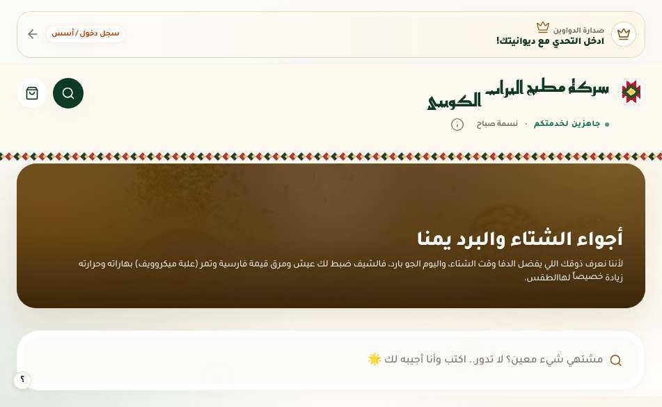 | 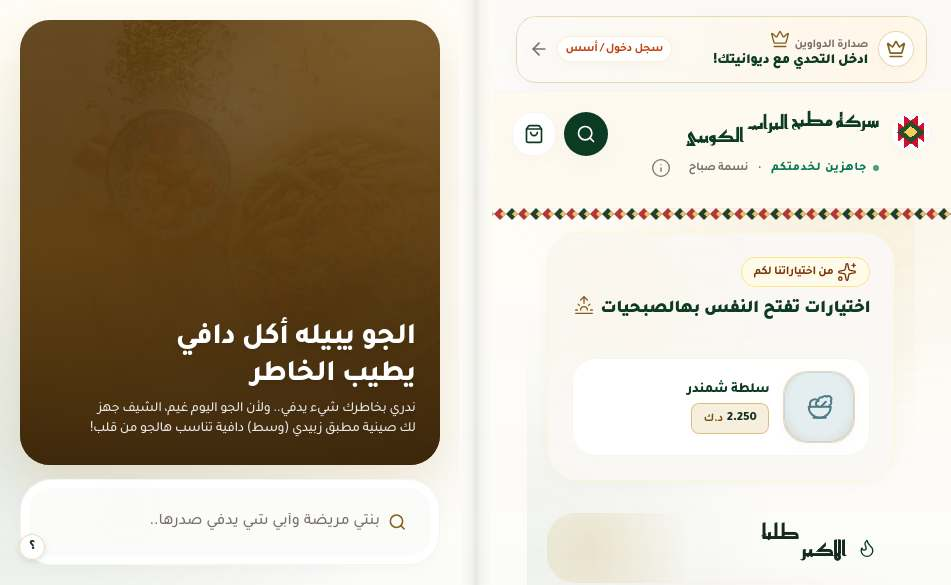 |
| المنيو 669×867 | 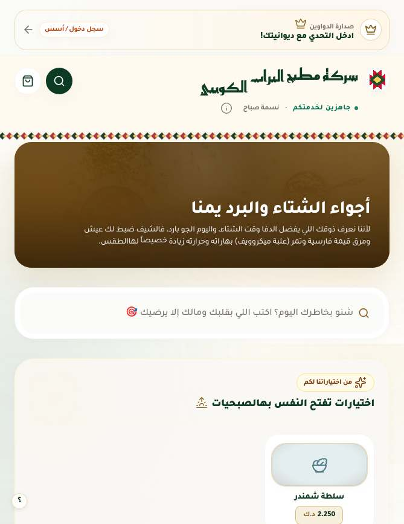 | 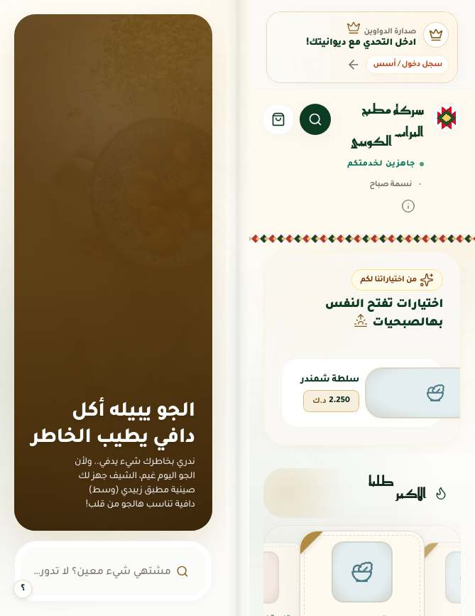 |
| ورقة المنتج 951×585 | 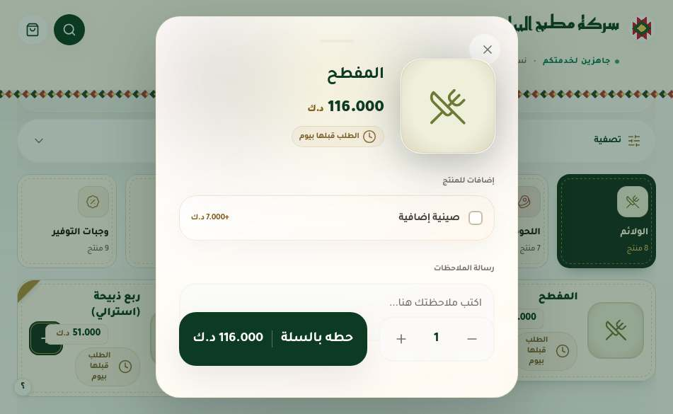 | 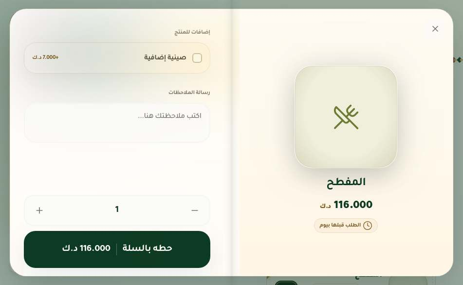 |
| الدفع 951×585 | 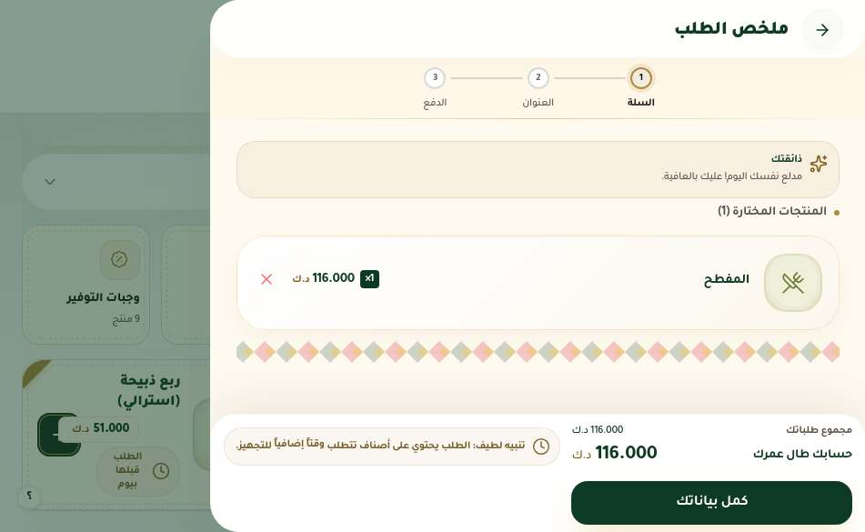 | 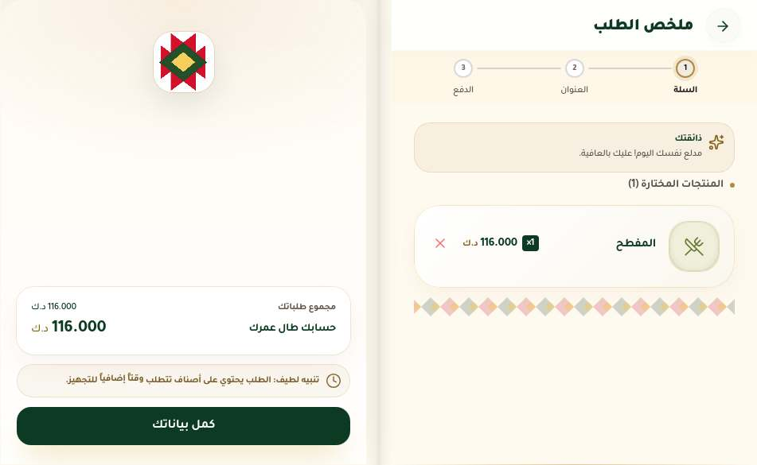 |
| التتبع 669×867 | 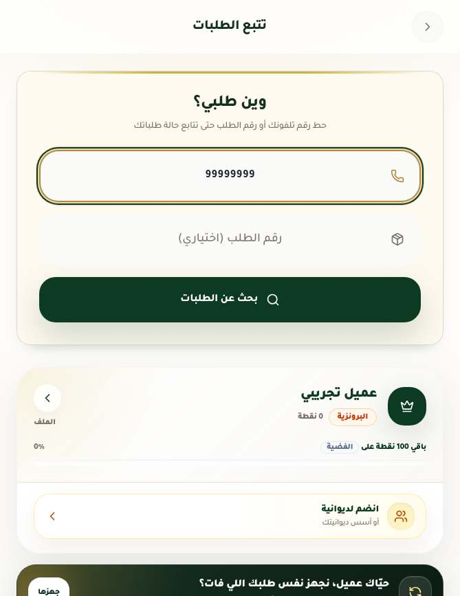 | 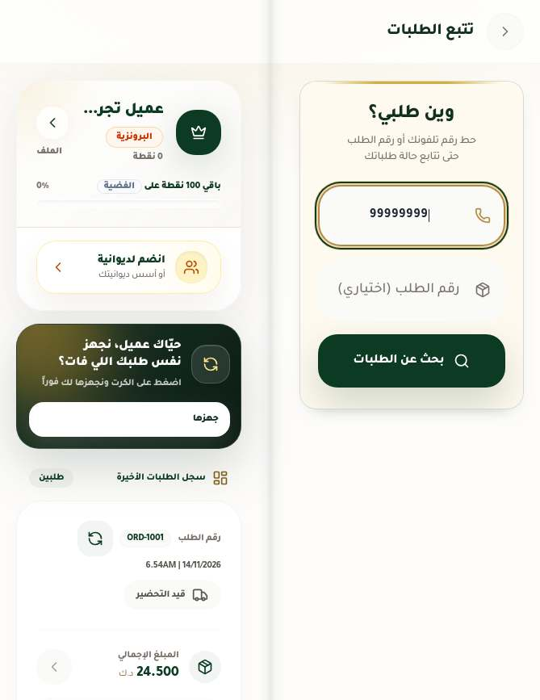 |
| المنتج لابتوب 951×350 | 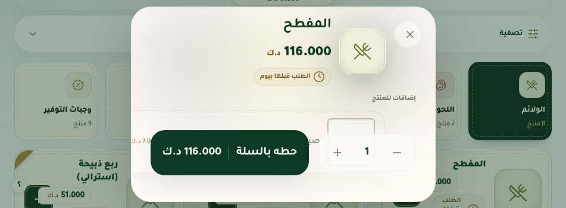 | 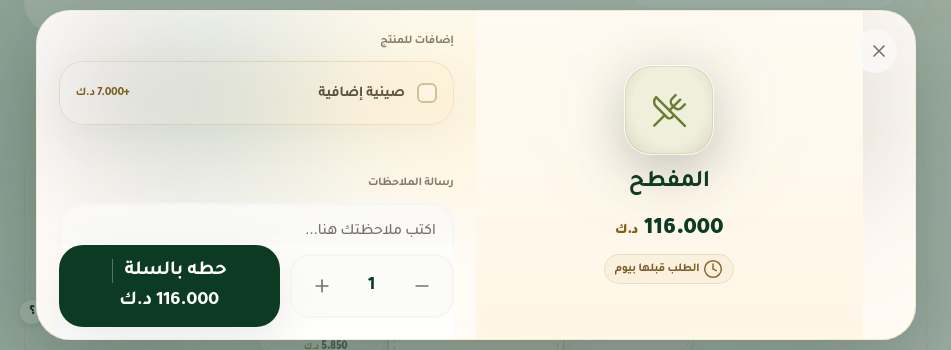 |

## 9. الأوامر

| الأمر | النتيجة |
|---|---|
| `npm run lint` (`tsc --noEmit`) | PASS |
| `npx vitest run` | PASS: 190/190 (4 اختبارات جديدة في `duo-audit.test.ts`: استعلامات الكتاب والكعب، غلاف الصفحة اليسرى `display: contents`، صنف النوافذ، ومحدِّد ورقة المنتج المصحَّح) |
| `npm run build` | PASS |
| `npx eslint .` | غير مشغَّل (ليس ضمن CI، وفيه 176 خطأ سابقًا على `main` حسب الجولة الماضية) |

### طريقة إعادة التدقيق

```
npm ci && npm run build
node docs/iphone-duo-final/serve.mjs 5160        # dist/ + قراءة المنيو الحية + طلبات تجريبية، والكتابة معطّلة
NODE_PATH=/opt/node22/lib/node_modules PLAYWRIGHT_BROWSERS_PATH=/opt/pw-browsers \
  node docs/iphone-duo-final/duo-final-audit.cjs    # المصفوفة -> docs/iphone-duo-final/report.json
NODE_PATH=/opt/node22/lib/node_modules PLAYWRIGHT_BROWSERS_PATH=/opt/pw-browsers \
  node docs/iphone-duo-final/duo-final-stress.cjs   # I وJ -> docs/iphone-duo-final/stress.json
```

متغيرات اختيارية: `DUO_URL`، `DUO_OUT` (مجلد الصور، الافتراضي `$TMPDIR/duo-final-shots`)، `DUO_ONLY=menu,product`، `DUO_VP=669x867,951x585`، `DUO_SHOTS=all|key|none`. التشغيل الكامل يستغرق ~35 دقيقة على جهاز محمَّل.

## 10. ما بقي

| الأولوية | البند |
|---|---|
| P0 | لا شيء معروف |
| P1 | المفصل الحقيقي: الكعب في منتصف النافذة. إن كان المفصل الفعلي غير متماثل (أو في وضع «نافذتين» مع Split View) فلن يطابقه. يحتاج قرار المالك برفع منع `viewport-segments` في الاختبار ثم إضافة طبقة تقدّمية معزولة |
| P1 | لم يُختبر على جهاز حقيقي. لوحة المفاتيح الحقيقية والحواف الآمنة الحقيقية لم تُقَس |
| P2 | نص 200% في الكتاب الطولي: زر «زيّد الكمية» في ورقة المنتج يخرج عن الحافة، وعنوان رأس التتبع يلامس المفصل |
| P2 | مقياس «عرض السلة خارج الحافة» يظهر أحيانًا في شاشة `cart-bar` على مقاس جوال أو قصير مختلف في كل تشغيل كامل (آخره 600×350) بعد الانتقال من مقاس مكتبي، ولا يتكرر حين يُعاد منفردًا، وظهر أيضًا في قياس «قبل» على `main`. يُرجَّح أنه لحظة حركة لشريط السلة |
| P2 | على الجوال (A، H) شريط «حطه بالسلة» اللاصق في ورقة المنتج يمر فوق الملاحظات أثناء التمرير (سلوك سابق، والملاحظات تصبح ظاهرة بالتمرير) |
| P2 | بطاقة الوهق اليسرى طويلة بطول الصفحة بإطارها، مقبولة لكنها أبسط من بقية الصفحات |

### BLOCKED / NOT_TESTED

| الشاشة | السبب |
|---|---|
| معاينة صورة المنتج | BLOCKED: لا توجد صور منتجات في بيانات المنيو الحالية، والمعاينة لا تفتح بلا صورة. الحاوية عليها `duo-page-dialog` |
| شاشة نجاح الطلب (`orderSuccess`) | BLOCKED: تحتاج إنشاء طلب حقيقي، وهو ممنوع |
| طلب الانضمام للديوانية، شرح الرادار، «التحقق قبل المتابعة»، نوافذ السدو والذكريات، التنبيهات | BLOCKED: تحتاج عضوية ديوانية وموقعًا وكتابة على الخادم. الحاويات عليها `duo-page-dialog` (مراجعة كود) |
| `NewInvoiceModal`، `OrderFormation` بحركة كاملة | NOT_TESTED (الحاويتان معلَّمتان) |
| `/admin/*` | N/A: تحويل فوري إلى admin.alturathkw.shop |
| حواف أمان غير متماثلة | NOT_TESTED: WebKit لا يحاكي `env(safe-area-inset-*)`. مراجعة كود: الصفحة اليسرى تأخذ `env(safe-area-inset-left)` على حافتها الخارجية، وتذييل الدفع وورقة المنتج والسلة تأخذ `safe-area-inset-bottom` |
| المفصل الحقيقي (Viewport Segments) | NOT_TESTED: لا يمكن محاكاته في WebKit، ولم تُضَف قواعده (انظر P1) |

## 11. فحص المالك على الجهاز

1. افتح الجهاز كتابًا عرضيًا (951×585 تقريبًا) على المنيو: هل الكعب على المفصل تمامًا؟ هل الأطباق يمينًا والبانر والبحث يسارًا، ولا نص على المفصل؟
2. أضف طبقًا: هل شريط السلة في أسفل الصفحة اليسرى فقط؟
3. افتح طبقًا: الصورة يمينًا، والإضافات والزر يسارًا؟
4. افتح السلة ثم «كمل بياناتك»: النموذج يمينًا والفاتورة والزر يسارًا؟
5. اكتب رقمًا في التتبع ثم أغلق الجهاز وافتحه: هل بقي الرقم والنتائج؟
6. أدر الجهاز طوليًا مفتوحًا (669×867): هل الصفحتان مقروءتان بلا كلمات مكسورة حرفًا حرفًا؟
7. وضع اللابتوب (951×350): في الدفع هل زر الخطوة التالية ظاهر دائمًا؟
8. افتح `/split/<رابط حقيقي>`: صفحة العنوان يسارًا والتبويبات يمينًا؟

## 12. النشر

لم يُشغَّل أي نشر. الدمج إلى `main` لا ينشر بنفسه من GitHub: سير العمل [deploy.yml](../.github/workflows/deploy.yml) («Deploy hosting») يدوي `workflow_dispatch` من `main` فقط (اختبار ثم بناء ثم Firebase Hosting، ويحتاج السر `FIREBASE_SERVICE_ACCOUNT`). المسار الآخر مُشغِّل Cloud Build `order-main-deploy` ([cloudbuild.yaml](../cloudbuild.yaml))، والجولة السابقة وجدته معطّلًا. و[deploy-watchdog.yml](../.github/workflows/deploy-watchdog.yml) يقارن كل ساعة `https://alturathkw.shop/build-id.json` مع `main`.
